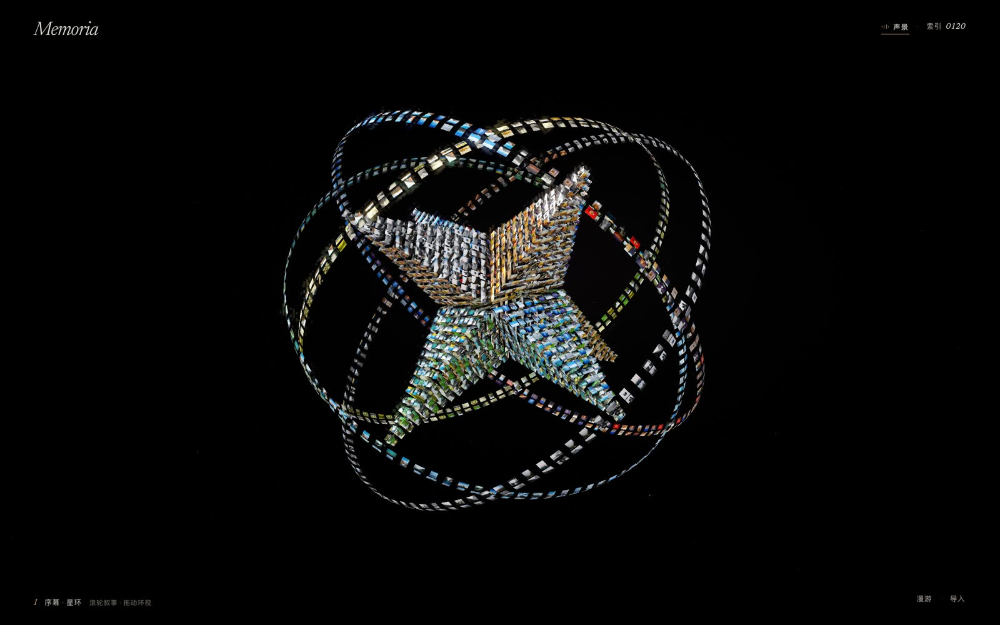
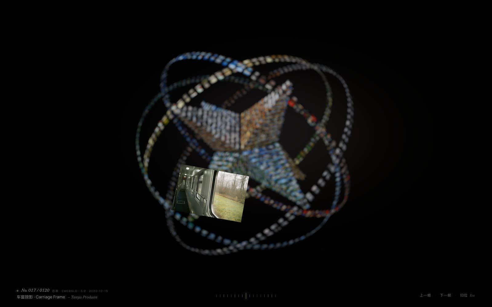
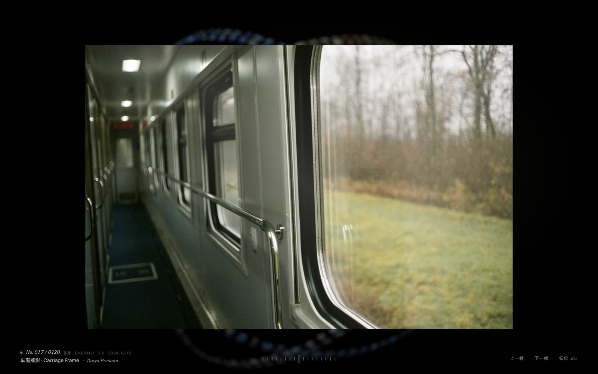
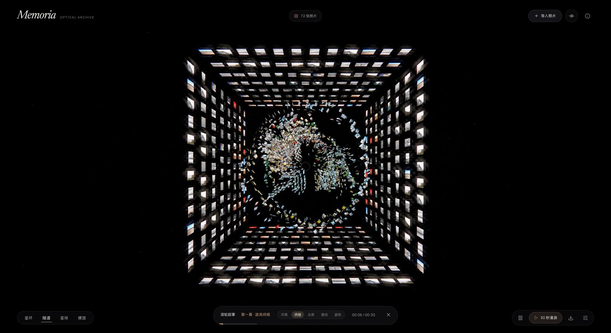
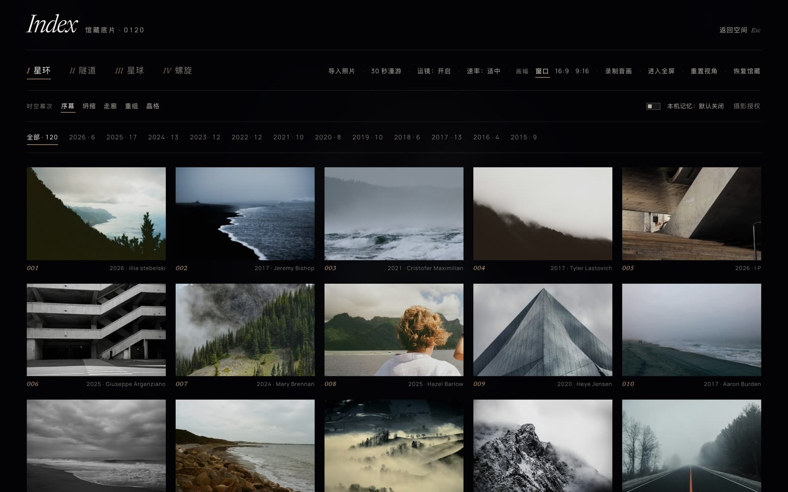

<div align="center">

# Memoria · 记忆的形状

**把多达 3,000 张照片显影为可漫游的 3D 色温星环、螺旋走廊与全画幅光学液态暗房**  
*A museum-grade 3D optical darkroom in WebGL — built with Three.js, custom GLSL shaders, and spatial chamber audio.*

[](https://plxc3.github.io/photo-universe/)
[](https://github.com/plxc3/photo-universe/releases/latest)
[](./LICENSE)

<p>
  <strong>🌐 免安装在线体验：</strong>
  <a href="https://plxc3.github.io/photo-universe/">https://plxc3.github.io/photo-universe/</a>
  &nbsp;·&nbsp;
  <strong>📦 不会用 Git？</strong>
  <a href="https://github.com/plxc3/photo-universe/releases/latest">点此直接下载最新 Release 源码压缩包（.zip）</a>
</p>



</div>

---

## ✨ 这是什么？

手机和硬盘里躺着几千张照片，却几乎不再翻看？  
**Memoria（记忆的形状）** 是一座纯浏览器运行的 **三维银盐暗房空间**：无需注册、无需后端、零上传服务器，把你散落的相册按 **OKLab 六大色温光谱** 与 **拍摄年份** 重新凝聚成一座悬浮于 `#020204` OLED 深空中的 **24 面超星形八面体与四重浑天仪星环**。

| 门扉光学散景（1.8s Rack-Focus） | 3D FLIP 丝滑离巢展映 |
| :---: | :---: |
|  |  |
| **全画幅 GLSL 液态交叉显影** | **龙卷风坍缩与无限螺旋走廊** |
|  |  |



---

## 🖼️ 零代码换成你自己的照片（100% 本地隐私）

甚至不需要下载代码——直接打开 **[在线体验地址](https://plxc3.github.io/photo-universe/)**：

1. **拖入相册**：把电脑里的照片文件夹或多选图片（支持 JPG / PNG / WebP，单次最多 **3,000 张**）直接拖进网页，或点击右下角 **`导入`**。
2. **自动色温与年代编排**：纯本地二进制解析 JPEG EXIF `DateTimeOriginal` 拍摄日期与画面主色温，自动生成 **年份章节索引** 与 **六大色温光谱星环**。
3. **可选本机持久化**：点击右上角 **`索引`** → 勾选 **`本机记忆`**，相册将保存在你当前浏览器的 IndexedDB 中（随时可一键清除），**全程 0 字节网络上传**。
4. **一键导出抖音 / 小红书高清视频**：在 **`索引`** 中选择 **`16:9`**（横屏 1920×1080）或 **`9:16`**（竖屏 1080×1920），点击 **`录制音画`**，即可直接导出 **18 Mbps 影院级 30 秒漫游 + 室内乐声景视频**。

---

## 🤖 让你的 AI 智能体一键部署与二创

如果你使用 **Claude Code、Cursor、Codex、Trae、Antigravity、Kimi、Windsurf** 等 AI 编程工具，仓库内置了完整的 [`AGENTS.md`](./AGENTS.md)。直接把下面这段话发给你的 AI 即可：

```text
请克隆 https://github.com/plxc3/photo-universe.git ，先阅读仓库根目录的 AGENTS.md，帮我安装依赖并启动本地预览，然后教我怎么把我的本地照片目录接进来或导出 16:9 / 9:16 漫游视频。
```

---

## 🚀 本地快速启动（Quick Start）

需要 **Node.js 20+**（推荐 Node.js 22）：

```bash
git clone https://github.com/plxc3/photo-universe.git
cd photo-universe
npm install
npm run dev
```

打开终端输出的本地地址（默认 `http://127.0.0.1:5178/`）即可体验。

```bash
npm test        # 运行全部 96 项单元与架构预算测试
npm run build   # 构建静态产物至 dist/（可部署至 GitHub Pages / Vercel / Cloudflare Pages）
```

---

## 🔬 核心光学与动效设计亮点

1. **门扉散景与 1.8 秒光学对焦（Threshold Gate Rack-Focus）**  
   首屏摒弃突兀跳变：120 张馆藏底片先在 `36°` 长焦柔焦散景帷幕后静静悬浮呼吸；首次轻滚滚轮或轻触屏幕时，同步唤醒大提琴/毛毡钢琴室内乐并完成 1.8 秒镜头拉远与焦点凝聚。
2. **Camera-Space 3D FLIP 离巢与归位**  
   点击任意倾斜晶面上的底片时，世界地平线保持绝对平稳（零镜头翻滚），目标底片沿法线微弧脱离晶格，经临界阻尼弹簧（`ζ = 1.0` 零回弹）与四元数球面插值（`Quaternion.slerp`）丝滑飞抵正前方展映位，背景 3,000 张底片同步化为柔滑光学散景；点击画面中央或按 `Esc` 原路旋回晶面卡槽。
3. **全画幅无边框 GLSL 液态置换显影（Liquid Displacement Crossfade）**  
   展映态下滚动滚轮、滑动触屏或点击画面左右侧缘，采用 `32×24` 细分曲面配合双纹理透镜折射波纹与相纸微卷曲着色器，在横构图与竖构图之间无缝流转。
4. **滚轮驱动五幕时空叙事（5-Act Scrollytelling）**  
   滚轮直接推进 `序幕·星环 → 坍缩·漩涡 → 走廊·螺旋 → 重组·门廊 → 终章·晶格` 五幕连续运镜，途中随时可按住鼠标自由环视偏航，松手平滑归位。
5. **无边框暗房排版与 2.2 秒静置全清场**  
   全站剔除一切廉价玻璃卡片与胶囊按钮，仅保留四角克制衬线字标；指针静止 `2.2s` 后界面 `100%` 溶解隐去，把纯粹的 `#020204` 暗房留给影像本身。
6. **严格显存预算与 96 项自动化测试**  
   针对桌面与移动端动态分配纹理图集分辨率（3,000 张照片桌面端像素预算约 `46.9 MiB`），所有 GPU 纹理、几何体、位图与音频轨道均经过闭环释放验证。

---

## ⌨️ 交互速查

| 场景 | 操作方式 |
| --- | --- |
| **主舞台漫游** | **滚轮**推进五幕时空叙事 · **拖拽**自由环视 · **轻点左下角幕次 / 右下角漫游**开启 30 秒自动运镜 |
| **查看单张底片** | **点击任意 3D 底片**飞出展映 · **滚轮 / 方向键 / 点击左右侧缘**切换上下帧 · **点击画面中央 / `Esc`** 丝滑归位 |
| **暗房接触印相** | 点击右上角 **`索引`** 打开全屏底片墙 · 支持切换 **星环 / 隧道 / 星球 / 螺旋** 四大形态与年份筛选 |
| **纯净舞台模式** | 按 **`H`** 键一键隐藏/恢复全部字标 · 按 **`Space`** 切换自动旋转 |

---

## 📂 目录结构

```text
photo-universe/
├── index.html              # 四角暗房字标、门扉呼吸层与接触印相 DOM 结构
├── AGENTS.md               # AI 智能体一键部署与定制指南
├── public/
│   ├── editorial/          # 24 张精选馆藏高分摄影 + 缩略图 + 授权清单
│   ├── archive/            # 96 张 2014–2025 年代馆藏摄影 + 缩略图 + 授权清单
│   ├── audio/              # 24 秒真实大提琴与毛毡钢琴无缝循环母带
│   └── fonts/              # Newsreader Italic & Manrope 本地可变字体（SIL OFL）
└── src/
    ├── main.js             # 交互状态机、滚轮叙事、索引帷幕与录制控制
    ├── scene.js            # Three.js 3,000 实例渲染、3D FLIP 与 GLSL 液态着色器
    ├── formations.js       # 星环、隧道、球面、双螺旋四大三维拓扑算法
    ├── flight.js           # 30 秒五幕电影样条曲线与自适应取景数学
    ├── photos.js           # 本地 EXIF 解析、OKLab 色温光谱与图集打包器
    ├── post.js             # 暗房胶片辉光、暗角、颗粒与色散后处理管线
    ├── audio.js            # Web Audio 空间声景与交互泛音合成器
    ├── storage.js          # 用户授权制 IndexedDB 本机相册持久化（AlbumVault）
    └── *.test.js           # 96 项单元与资源预算测试套件
```

---

## 📜 开源协议与致谢（License & Credits）

- **源代码**：基于 [MIT License](./LICENSE) 开源，欢迎自由使用、修改与二创分享。
- **内置馆藏摄影**：共 120 幅精选作品，均遵循 Unsplash License 离线封装，完整摄影师署名详见 [`public/editorial/SOURCES.md`](./public/editorial/SOURCES.md) 与 [`public/archive/SOURCES.md`](./public/archive/SOURCES.md)。
- **字体**：`Newsreader` 与 `Manrope` 遵循 SIL Open Font License 1.1（详见 [`public/fonts/SOURCES.md`](./public/fonts/SOURCES.md)）。
